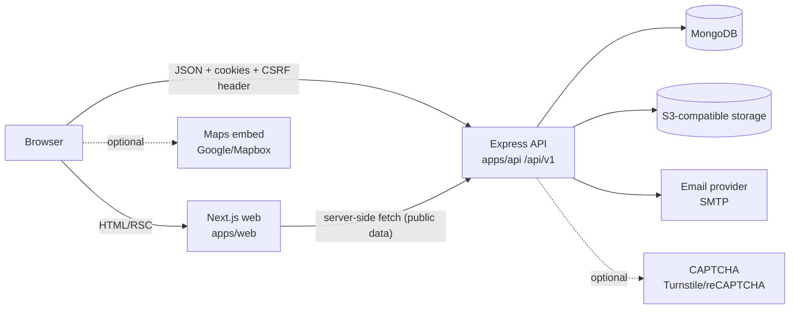
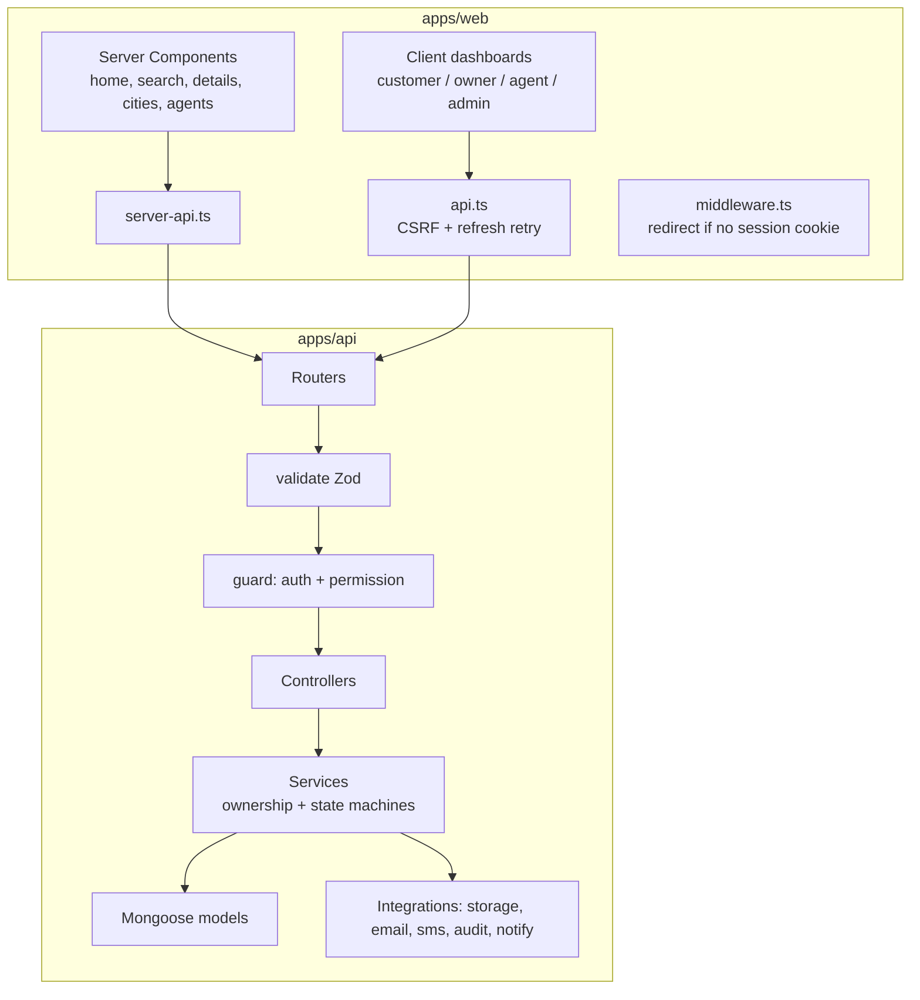
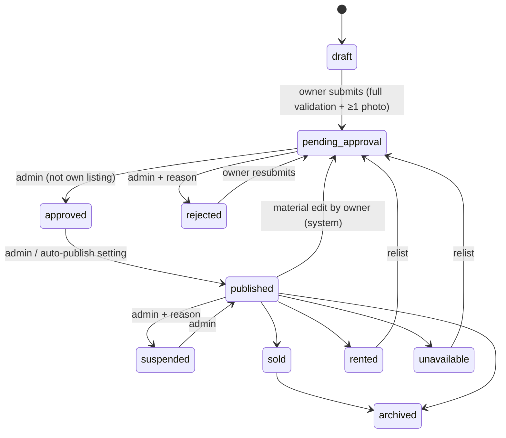

# Architecture — Sky Space Realty

## 1. Requirements summary (SRS)

Sky Space Realty is a production-oriented Indian real estate platform covering **residential and commercial** property for **sale and rent**.

| Area | Scope implemented |
|---|---|
| Discovery | Server-side search with 25+ filters, URL-driven state, sorting, pagination, text search, geo-radius, city/locality pages |
| Listings | Draft → Pending Approval → Approved → Published workflow, Rejected/Suspended/Sold/Rented/Unavailable/Archived, status history, re-approval on material edits |
| Leads | Enquiries with duplicate/honeypot/rate-limit protection, assignment, statuses, notes, follow-ups, CSV export |
| Site visits | IST slot booking, owner/agent confirmation, reschedule handshake, race-safe double-booking prevention |
| Accounts | Customer, Owner, Agent, Admin roles; JWT access + rotating refresh tokens in httpOnly cookies; password reset; email verification |
| Admin | Live KPIs & charts, moderation queue, user/role management, agents, catalogue (cities/localities/categories), CMS, complaints, audit log, settings |
| India-specific | ₹ lakh/crore formatting, +91 phone normalisation, 6-digit PIN validation, sq.ft/sq.m, IST, RERA number field (configurable, never assumed) |

Non-goals for v1 (see `limitations.md`): payments, real SMS/OTP delivery, saved-search alert job, document vault.

## 2. System context



* **Next.js (App Router)** renders public pages on the server (SEO) and hosts client-side dashboards. It never talks to MongoDB and has **no API routes** — the Express API is the only backend.
* **Express API** owns all business rules, validation (Zod), authorisation and data access (Mongoose).
* **Shared package** (`packages/shared`) holds constants, Zod schemas, the permission matrix, state machines and formatters, used by both apps so the browser and server validate identically.

## 3. Monorepo layout

```text
SkySpace/
├── apps/
│   ├── api/                 Express 5 + Mongoose API
│   │   ├── src/config        env (Zod-validated), db
│   │   ├── src/middleware    auth, csrf, validate, sanitize, rate limits, upload, errors
│   │   ├── src/models        Mongoose schemas + indexes
│   │   ├── src/modules       auth, users, properties, enquiries, site-visits, agents, admin, content
│   │   ├── src/services      email, sms, storage, captcha, audit, notifications, site-config
│   │   ├── src/docs          OpenAPI generator
│   │   ├── src/scripts       seed, memdb, write-openapi
│   │   └── test              supertest integration tests (in-memory MongoDB)
│   └── web/                 Next.js 15 + Tailwind 4
│       ├── src/app           (public), (auth), customer, owner, agent, admin routes
│       ├── src/components    ui, layout, property, search, dashboard
│       ├── src/features      auth, shortlist, listings, leads, visits, admin
│       ├── src/lib           API clients, config, search-param helpers
│       ├── test              Vitest + Testing Library
│       └── e2e               Playwright journeys
├── packages/shared          types, Zod schemas, permissions, state machines, formatters
├── docs/                    this documentation + generated openapi.json
└── .github/workflows/ci.yml
```

> The original brief listed `shared-types` and `shared-validation` as separate packages. They are merged into one `@skyspace/shared` package because the types are inferred from the Zod schemas — splitting them would duplicate definitions.

## 4. Component view



Request pipeline: `helmet → cors(allow-list) → pino-http → json(200kb) → cookie-parser → rate limit → query/body sanitiser → CSRF → router → validate → guard → controller → service → error handler`.

## 5. Security model

| Concern | Implementation |
|---|---|
| Passwords | Argon2id (19 MiB, t=2), timing-equalised unknown-email path, 5-failure / 15-min lock |
| Tokens | 15-min HS256 access JWT (`ssr_at`), 48-byte refresh token (`ssr_rt`, path-scoped to `/api/v1/auth`) stored as HMAC hash; rotated on each refresh; reuse of a rotated token revokes the session |
| Revocation | Every request re-loads user + session; suspension, password change, role change and logout-all revoke sessions immediately |
| Cookies | httpOnly, `SameSite=Lax`, `Secure` in production, optional parent `COOKIE_DOMAIN` |
| CSRF | Double-submit token (`ssr_csrf` cookie + `X-CSRF-Token` header) on every unsafe method |
| Authorisation | Permission matrix (`packages/shared/src/permissions.ts`) checked in route guards; ownership/assignment checked in services; other users’ records return **404** (no ID disclosure) |
| Input | Zod on every body/query/param; `$`/dotted keys stripped; nested query objects rejected; HTML tags stripped from stored text; 200 KB body limit |
| Uploads | MIME allow-list + magic-byte sniffing, 5 MB/file, 10/request, 20/listing, random object keys |
| Abuse | Rate limits (login, register, reset, enquiry, upload, global), enquiry honeypot + duplicate window, optional CAPTCHA |
| Privacy | Enquirer contact data is never in property APIs; owner contact shown only with opt-in; approximate-location mode; leads anonymised by retention job |
| Headers | helmet on API; HSTS, nosniff, frame, referrer, permissions policy on web; `X-Robots-Tag: noindex` on dashboards |
| Audit | Moderation, role/status changes, exports, config/content changes → `AuditLog` (secrets filtered) |

## 6. Key workflows

### Listing lifecycle

Defined once in `packages/shared/src/status.ts` and enforced by `property.service.ts#transition`. Every change writes `ListingStatusHistory` and notifies the owner.

### Site visit
`pending_confirmation → confirmed | rejected | cancelled`, `confirmed → completed | no_show | cancelled`, any active state → `rescheduled` (the **other** party must accept). Confirmation sets unique `propertySlotLock` / `agentSlotLock` keys so two confirmations for the same slot cannot both succeed, even concurrently.

## 7. Time zones
All instants are stored in UTC. Visit `date`/`timeSlot` hold the IST wall-clock the customer picked; `scheduledAt = istToUtc(date, slot)`. Display uses `Intl.DateTimeFormat('en-IN', { timeZone: 'Asia/Kolkata' })`. Dashboard buckets use `$dateTrunc` with `timezone: 'Asia/Kolkata'`.

## 8. Technology versions

| Package | Version |
|---|---|
| Node.js | ≥ 20.11 (developed on 24.x) |
| Next.js / React | 15.5.28 / 19.2.9 |
| Tailwind CSS | 4.1.17 |
| TypeScript | 5.9.3 (strict, `noUncheckedIndexedAccess`) |
| Express | 5.1.0 |
| Mongoose / MongoDB | 8.24.7 / 7.0 (tested) |
| Zod | 3.25.76 |
| argon2 / jsonwebtoken | 0.45.1 / 9.0.3 |
| Vitest / Playwright | 3.2.7 / 1.56.1 |
| Recharts | 2.15.4 |
