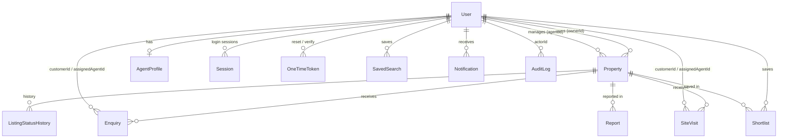

# Database schema (MongoDB + Mongoose)

Models live in `apps/api/src/models`. All collections have `createdAt`/`updatedAt` unless noted. Money is stored as **integer rupees**; areas in the listing’s `areaUnit` plus a normalised `areaSqft`.

## Relationships

## Collections

| Model | Purpose | Key fields |
|---|---|---|
| **User** | Accounts | `email` (lower-case, unique), `phone` (E.164 `+91…`, unique), `passwordHash` (select:false), `roles[]`, `status` (active/suspended/deactivated), `emailVerified`, `phoneVerified`, `lastLoginAt`, `failedLoginCount`, `lockedUntil` |
| **Session** | Refresh-token sessions | `userId`, `tokenHash` (HMAC), `previousTokenHashes[]` (reuse detection), `expiresAt`, `revokedAt`, `ip`, `userAgent` |
| **OneTimeToken** | Password reset / email verification | `purpose`, `tokenHash`, `expiresAt` (TTL), `usedAt` |
| **Property** | Listings | `propertyId` (SSR100001), `slug`, sale/rent pricing, `priceValue` (denormalised), address + `citySlug`/`localitySlug`, `location` GeoJSON Point, rooms, areas + `areaSqft`, furnishing, floor, possession, amenities, `nearby[]`, `reraNumber`, **embedded `images[]`**, `ownerId`, `agentId`, `status`, `verificationStatus`, `featured`, `moderationComment`, `stats{views,enquiries,shortlists,visits}` |
| **ListingStatusHistory** | Audit trail per listing | `propertyId`, `previousStatus`, `newStatus`, `changedBy`, `comment` |
| **Enquiry** | Leads | `propertyId`, `ownerId` (denormalised), `customerId`, `assignedAgentId`, contact fields, `source`, `enquiryType`, `status`, `followUpAt`, `notes[]`, `history[]`, `consentAt`, `anonymisedAt` |
| **SiteVisit** | Visit requests | `propertyId`, `ownerId`, `customerId`, `assignedAgentId`, contact, `scheduledAt` (UTC), `date`+`timeSlot` (IST), `status`, `confirmedAt`, `rescheduledBy`, `propertySlotLock`, `agentSlotLock`, `notes[]`, `history[]` |
| **Shortlist** | Saved properties | `userId`, `propertyId` |
| **SavedSearch** | Saved filters | `userId`, `name`, `filters` (validated map), `notificationEnabled` |
| **Notification** | In-app notifications | `userId`, `type`, `title`, `message`, `link`, `readAt` |
| **AuditLog** | Sensitive admin actions | `actorId`, `action`, `entityType`, `entityId`, `metadata` (keys matching pass/token/secret/hash/otp are dropped), `ip` |
| **Category** | Configurable property types | `slug`, `name`, `category`, `active`, `order` |
| **City** | Configurable cities | `slug`, `state`, `popular`, `active`, `imageUrl`, embedded `localities[{name,slug,pinCodes}]` |
| **AgentProfile** | Public agent data | `userId` (unique), `slug`, agency, bio, RERA agent no., cities, languages, `publicProfile` |
| **Report** | Listing complaints | `propertyId`, `reporterId`/`email`, `reason`, `details`, `status`, `resolution`, `resolvedBy` |
| **SiteConfig** | Singleton CMS + settings (`key: "main"`) | `banners`, `faqs`, `testimonials`, `pages`, `seo`, `settings` |
| **Subscriber** | Newsletter | `email` (unique), `consentAt` |
| **Counter** | Sequences | `_id` name, `seq` (for `propertyId`) |

### Why images are embedded
A listing has at most 20 images (enforced), they are always read with the listing, and ordering is per listing. Embedding avoids a join on every card/detail read. Files live in object storage; MongoDB stores only `key`, `url`, `altText`, `order`, `mimeType`, `size`, `uploadedBy`, `uploadedAt`.

## Conditional validation
Zod (`packages/shared/src/schemas/property.ts#refineProperty`) enforces on submit: sale ⇒ `price`; rent ⇒ `monthlyRent` (and no rent on sale); plots ⇒ `plotArea`, no bedrooms; non-plots ⇒ carpet or built-up area; carpet ≤ built-up; residential non-plot ⇒ `bedrooms`; floor ≤ total floors; under construction ⇒ `possessionDate`. Drafts accept partial data but every supplied field is still validated.

## Indexes and the queries they serve

| Collection | Index | Query |
|---|---|---|
| Property | `{propertyId:1}` unique, `{slug:1}` unique | ID lookups, detail page |
| Property | `{status, transactionType, propertyCategory, citySlug, priceValue}` | Main search (buy/rent × category × city, price range/sort) |
| Property | `{status, citySlug, localitySlug, publishedAt:-1}` | City/locality pages, newest in locality |
| Property | `{status, publishedAt:-1}` | “Recently added”, newest sort |
| Property | `{status, featured, publishedAt:-1}` | Homepage featured, relevance sort |
| Property | `{status, propertyType, publishedAt:-1}` | Type filters, similar listings |
| Property | `{status, pinCode}` | PIN code search |
| Property | `{ownerId, status, updatedAt:-1}`, `{agentId, status, updatedAt:-1}` | My listings |
| Property | `{status, submittedAt}` | Approval queue (oldest first) |
| Property | `{location:'2dsphere'}` | Radius search (`lat`,`lng`,`radiusKm`) |
| Property | text(title 10, projectName 8, locality 6, city 4, description 1) | Keyword search |
| Enquiry | `{assignedAgentId, status, createdAt:-1}` | Agent lead list |
| Enquiry | `{ownerId, createdAt:-1}`, `{customerId, createdAt:-1}` | Owner / customer lists |
| Enquiry | `{propertyId, phone, createdAt:-1}` | Duplicate check, visit→lead link |
| Enquiry | `{status, createdAt:-1}`, `{followUpAt}` sparse | Admin lists, follow-ups |
| SiteVisit | `{propertySlotLock}` unique sparse, `{agentSlotLock}` unique sparse | Double-booking prevention |
| SiteVisit | `{customerId, scheduledAt:-1}`, `{assignedAgentId, scheduledAt}`, `{ownerId, scheduledAt}`, `{propertyId, status, scheduledAt}`, `{status, scheduledAt}` | Lists & conflict checks |
| Shortlist | `{userId, propertyId}` unique | Idempotent shortlist |
| Session | `{tokenHash}` unique, `{previousTokenHashes}`, TTL on `expiresAt` (+7d) | Refresh rotation, reuse detection |
| OneTimeToken | `{tokenHash}` unique, TTL on `expiresAt` | Reset/verify |
| Notification | `{userId, createdAt:-1}`, `{userId, readAt}`, TTL 180 days | Inbox, unread count |
| AuditLog | `{createdAt:-1}`, `{entityType, entityId, createdAt:-1}`, `{actorId, createdAt:-1}` | Audit views |
| User | `{email}` unique, `{phone}` unique, `{roles, status}`, `{createdAt:-1}` | Login, admin filters |

Validate with representative data: `db.properties.find({...}).explain('executionStats')` should show `IXSCAN` and `totalDocsExamined ≈ nReturned` for the search patterns above. All list endpoints cap `limit` at 50 and `page` at 500–1000.

## Dashboard metrics
`apps/api/src/modules/admin/dashboard.service.ts` — every number is a live `countDocuments`/`aggregate`:

* **KPIs** — users (status ≠ deactivated), active agents, properties (status ≠ archived), published, pending, sold, rented, new enquiries (`status=new`), open leads (status ∉ converted/closed/invalid), upcoming visits (active statuses with `scheduledAt ≥ now`).
* **Time series** — `$dateTrunc` on `createdAt` in IST; unit = day (≤45 days), week (≤200 days), month otherwise.
* **Distributions** — published listings grouped by city / transaction type / category / property type; leads and visits grouped by status for the range.
* **Conversion rate** — converted ÷ leads created in range; `null` (shown as “—”) when fewer than 10 leads.

## Deletion & retention policy
* Listings are **archived**, never hard-deleted by owners; history and leads stay intact.
* Categories/cities can only be deleted when unused; otherwise deactivate.
* Users are suspended/deactivated, not deleted (keeps audit integrity). Erasure requests: anonymise the user + their leads via a manual script (see limitations).
* Leads: `anonymiseOldLeads(months=24)` in `enquiry.service.ts` replaces contact data on closed/converted/invalid leads. Schedule it (e.g. daily cron) in production.
* TTLs: sessions (7 days after expiry), one-time tokens (at expiry), notifications (180 days).

## Transactions
The deployment works on standalone MongoDB; no multi-document transaction is required for correctness: listing status + history writes are idempotent append-only, and slot conflicts are prevented by unique indexes rather than transactions. MongoDB Atlas (replica set) supports transactions if future features need them.
